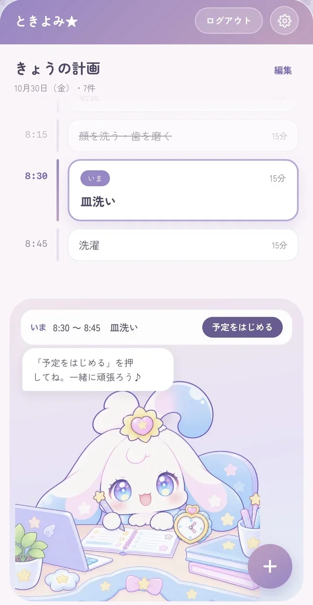
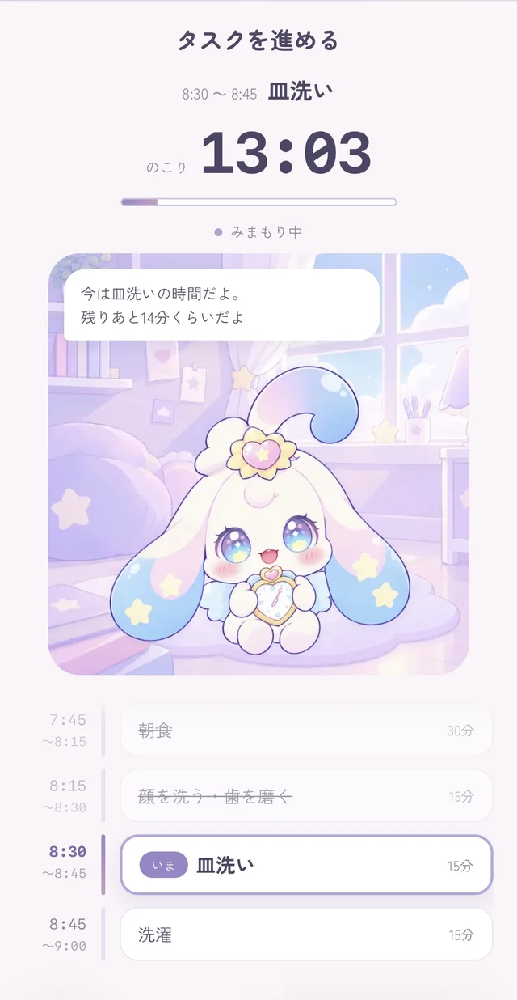
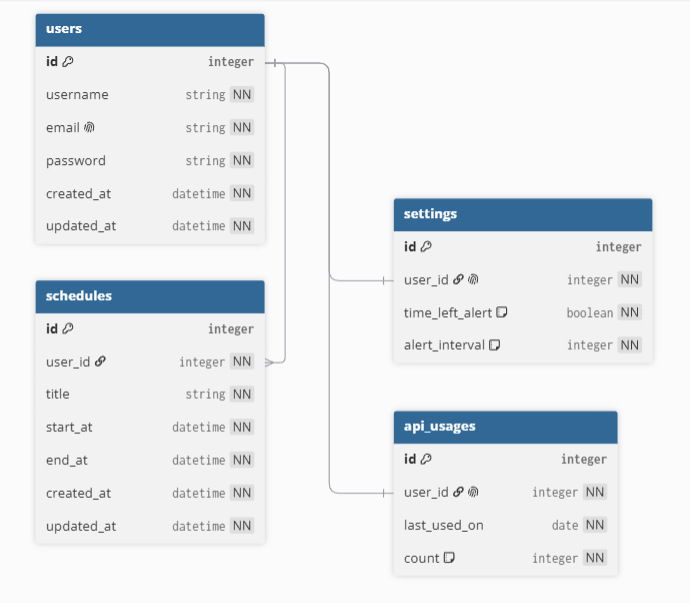
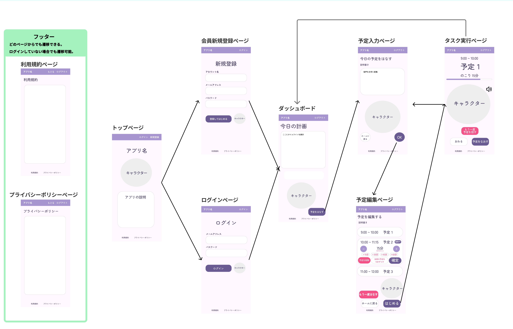

## ときよみ★
### 1. アプリURL
https://voice-schedule-app-web.onrender.com/

### 2. アプリ紹介
キャラクター「るるる」と一緒に効率的にタスクを進められる、時間管理型タスクアプリです。
**本アプリの特長**

- タスクを音声入力することができます。入力に手間がかかりません。
- タスク開始・終了時刻を音声でお知らせします。余計なスマホ通知に気を取られません。
- キャラクターが作業を見守ります。「見守り」は集中力向上効果があるとされています。

<p align="center">
  
  
</p>

### 3. 制作背景
プログラミングスクールでの内容・統計学・SQLを並行して学んでおり、効率的な時間の使い方を模索していました。従来のタスク管理アプリは効果的ですが、入力に少々手間がかかること、プッシュ通知によるお知らせは気が散りやすいと感じていたため、音声入力・音声通知であればその課題が解決できると考えました。また、最近人気の「Study With Me」動画のように、誰かと一緒に作業を進めている感覚が得られるとよいと考えたため、キャラクターを導入しました。
なお、制作背景について詳しくは[企画書](docs/planning.md)をご覧ください。

### 4. 主な機能
| 機能 | 内容 |
|---|---|
| タスク音声入力 | タスクを話すだけで、AIが「開始時刻・タスク名・終了時刻」に変換して表示します |
| タスク編集・追加 | タスク編集や追加、時間修正等は手入力でも行えます |
| 複数タスクをまとめて時刻変更 | １つのタスクの時刻を変更した場合、以降のタスク開始時刻をまとめて前倒し・後ろ倒しすることができます |
| タスク時刻音声お知らせ | 設定したタスクの開始時刻・終了時刻を音声でお知らせします |
| 残り時間お知らせ | タスクの残り時間を15分ごとにお知らせします |
| キャラクターの見守り | キャラクターがあなたの作業を見守ります |

### 5. 使用技術・選定理由
#### フロントエンド

| 技術 | 選定理由 |
|---|---|
| Django テンプレート / JavaScript | 画面数は比較的少ないことから、Reactを用いてフロントエンドとバックエンドを分ける必要がないため |
| Tailwind CSS v4（django-tailwind） | HTMLに直接指定できることから、UIの調整がしやすいため |

#### バックエンド

| 技術 | 選定理由 |
|---|---|
| Python 3.12 / Django 5.2 | 本アプリに必要なユーザー登録・ログイン等の機能が揃っているため |
| PostgreSQL | 無料のデプロイ先データベース（Render・Neon）が対応しているRDBMSであるため |

#### AI・音声

| 技術 | 選定理由 |
|---|---|
| Web Speech API | 無料で利用でき、ブラウザ内で完結するため。音声入力及びGemini APIエラー時の読み上げに使用 |
| OpenAI API | 話し言葉を定型のJSONに加工する処理はAIの使用が適切と考えたため。OpenAI APIは使用経験があり、使い方を理解した上で実装できたため |
| Gemini API | アプリに合う声質を生成でき、抑揚や発音・読み方のぶれが少ないため（ElevenLabs・Fish Audioと比較） |
| Screen Wake Lock API | 画面を開いたまま使用してもらう必要があるため（画面ロック状態では音声が再生されないため） |

#### インフラ・開発環境

| 技術 | 選定理由 |
|---|---|
| Render | GitHubと連携し、無料でデプロイできるため |
| Gunicorn / WhiteNoise | Viewに非同期処理がなく、ASGIで動かす必要がないため |
| Neon | 期限なく無料で利用できるため |
| Docker / Docker Compose | OSの違いによる動作の差をなくすため。また同じ環境を誰でも再現できるため |

#### テスト・品質

| 技術 | 選定理由 |
|---|---|
| Django のテスト機能 / factory_boy | テストデータ作成の共通化・簡潔化のため |
| ruff / GitHub Actions | プルリクエストの度に、書き方の自動チェック・自動テストが可能なため |

### 6. 工夫した点

**キャラクターの動き**

イラストをパーツごとに分けてCSSで動かすことにより、アニメーションとして表示できるようにしました。

**キャラクターの声**

キャラクターの見た目に合う声質になるよう工夫しました。OpenAIのTTS・ElevenLabs・Fish Audio・Google CloudのTTS等を試した上で、Gemini APIの機能で独自の声質を生成し、採用しました。

**音声再生・生成**

Gemini APIは音声生成に数秒かかるため、お知らせ音声が遅延しないように工夫しました。最初の音声としてあらかじめ用意した音声ファイルを再生し、その間に次の音声を生成しています。また、開始時刻・終了時刻のお知らせ音声は、15秒前に生成指示を送り、時刻ちょうどに再生されるようにしています。

### 7. 今後改善したい内容
- 設定画面・メールアドレス変更・パスワード変更（本リリースで対応予定）
- 明日以降の予定・カレンダー機能

### 8. 補足資料
- 「ときよみ★」企画書：[planning.md](docs/planning.md)
- ER図：下記画像のとおり



- 画面遷移図：下記画像のとおり



### 9. ローカル環境での起動手順
```bash
# リポジトリをクローン
git clone https://github.com/ae-ohagi2428/voice-schedule-app.git
cd voice-schedule-app

# 環境変数ファイルを用意（.env）
# 以下を設定してください
# - SECRET_KEY
# - POSTGRES_PASSWORD
# - OPENAI_API_KEY（予定の読み取りに使用）
# - GEMINI_API_KEY（キャラクターの声の生成に使用）

# Docker で起動
docker compose up -d

# マイグレーション
docker compose exec web python manage.py migrate
```

起動後、http://localhost:8000 にアクセスしてください。